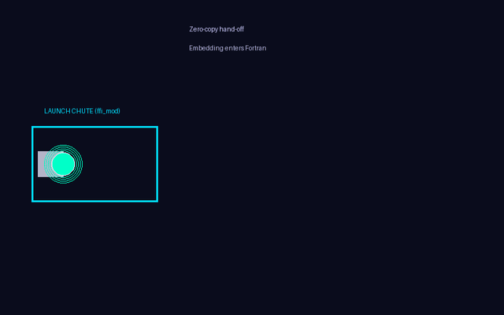
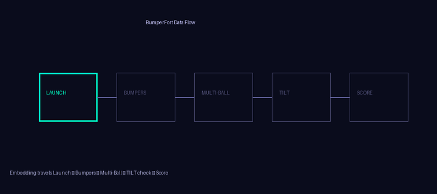

# BumperFort


```text
██████╗ ██╗   ██╗███╗   ███╗██████╗ ███████╗██████╗ ███████╗ ██████╗ ██████╗ ████████╗
██╔══██╗██║   ██║████╗ ████║██╔══██╗██╔════╝██╔══██╗██╔════╝██╔═══██╗██╔══██╗╚══██╔══╝
██████╔╝██║   ██║██╔████╔██║██████╔╝█████╗  ██████╔╝█████╗  ██║   ██║██████╔╝   ██║   
██╔══██╗██║   ██║██║╚██╔╝██║██╔═══╝ ██╔══╝  ██╔══██╗██╔══╝  ██║   ██║██╔══██╗   ██║   
██████╔╝╚██████╔╝██║ ╚═╝ ██║██║     ███████╗██║  ██║██║     ╚██████╔╝██║  ██║   ██║   
╚═════╝  ╚═════╝ ╚═╝     ╚═╝╚═╝     ╚══════╝╚═╝  ╚═╝╚═╝      ╚═════╝ ╚═╝  ╚═╝   ╚═╝   
```

**High-Velocity Vector Physics & Trajectory Engine** for the Local-First Industrial Software Factory

[](LICENSE)


## Bounce Kernel

Supports hot ROM swaps via double-buffered playfields.

Pure Fortran reduction and reflection kernels with a fixed, deterministic evaluation order. No BLAS dependency yet — planned Accelerate/AMX backend is tracked in `docs/limitations-and-future.md`.

High-dimensional vector bounce calculations using real64 precision, with deterministic trajectories.

## The metaphor in 30 seconds

A ball (your query embedding) is launched zero-copy through the C ABI
(`ffi_mod`), bounces against the bumpers (fused cosine kernels in
`physics_mod`), is played multi-ball against a lane of documents
(`batch_cosine`), rakes up a score card (`top_k_cosine`), while the
TILT guard (`telemetry_mod` + `coarray_mod`) watches CPU/memory/
temperature and NaNs and stops the game before it can produce garbage.

Every arcade element maps to an exact code symbol — see
`docs/metaphor-guide.md`, or run the narrated tour:

```bash
fpm run --example metaphor_tour
```

## Visual Flow






## Vision

BumperFort is a Modern Fortran physics coprocessor that treats agent embeddings and hardware telemetry as physical objects. Launch → Bump → Multi-ball → TILT → Score.

## Quick start

```bash
git clone https://github.com/hamanakam1/bumperfort.git
cd bumperfort
fpm build
fpm test
fpm run --example single_query
```

## Learning path

See `docs/learning-path.md` for the staged study guide. Start with `docs/architecture.md` and `docs/ffi-explained.md`.

## Status

v0.1.1 — corrected kernels + out-of-the-box build; educational + usable core. See `docs/limitations-and-future.md` and `CHANGELOG.md`.

## Sensors

## Mesh

Shared memory ring buffer.

Hardware telemetry polling.

## Links

- Metaphor guide (start here): `docs/metaphor-guide.md`
- Architecture: `docs/architecture.md`
- FFI deep dive: `docs/ffi-explained.md`
- Physics kernels: `docs/physics-kernels.md`
- Coarrays & TILT: `docs/coarrays-and-tilt.md`
- Learning path: `docs/learning-path.md`
- Strategy: `docs/strategy.md`
- Roadmap: `docs/roadmap.md`

## License

MIT © 2026 Mike Hamanaka

## Contributing

Contributions welcome! See [CONTRIBUTING.md](CONTRIBUTING.md) and [docs/contributing-ideas.md](docs/contributing-ideas.md). Good first issues are labeled. Educational contributions are especially valued.


## Arcade Cabinet Specs (Benchmarks)

```bash
make bench     # C-ABI client against the static library
make test-leaks  # verify zero heap allocations after initialization
```

For Python: `make dylib` produces `libbumperfort.dylib` for the ctypes binding (see `bindings/python/README.md`).
